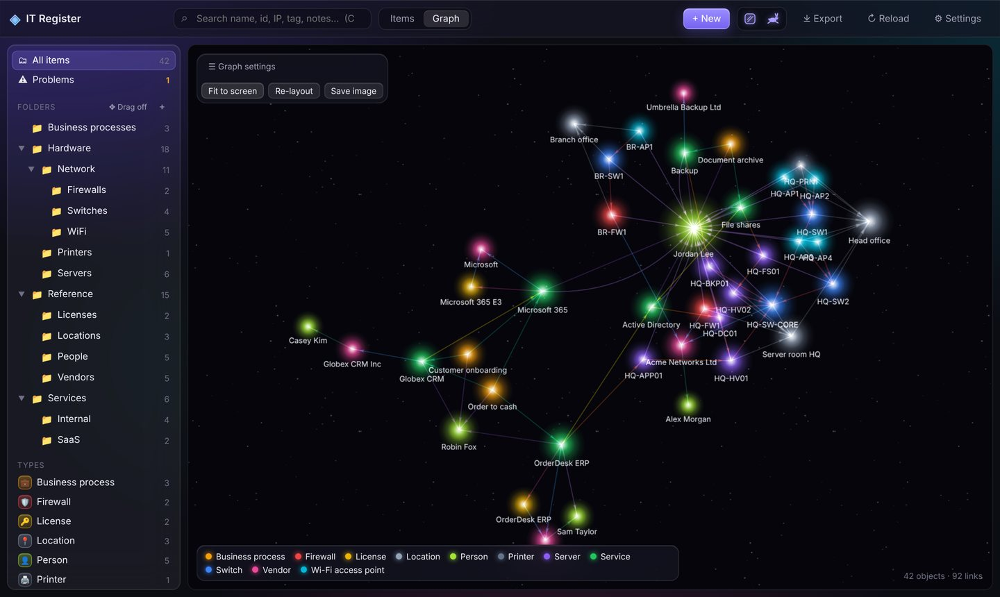
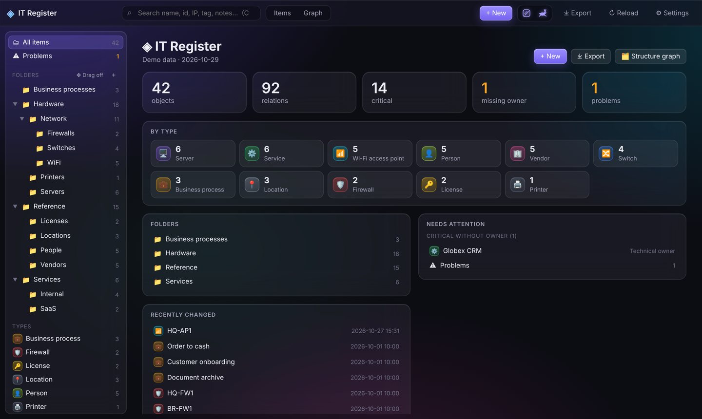
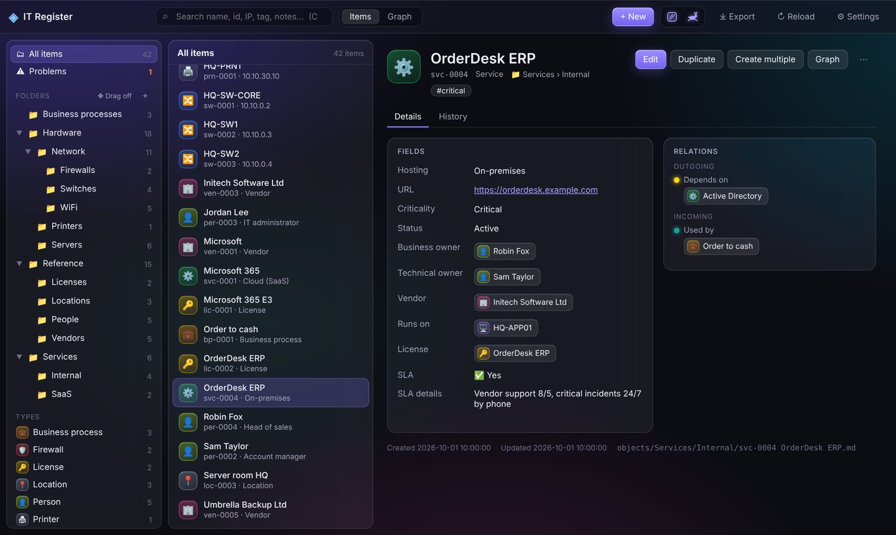
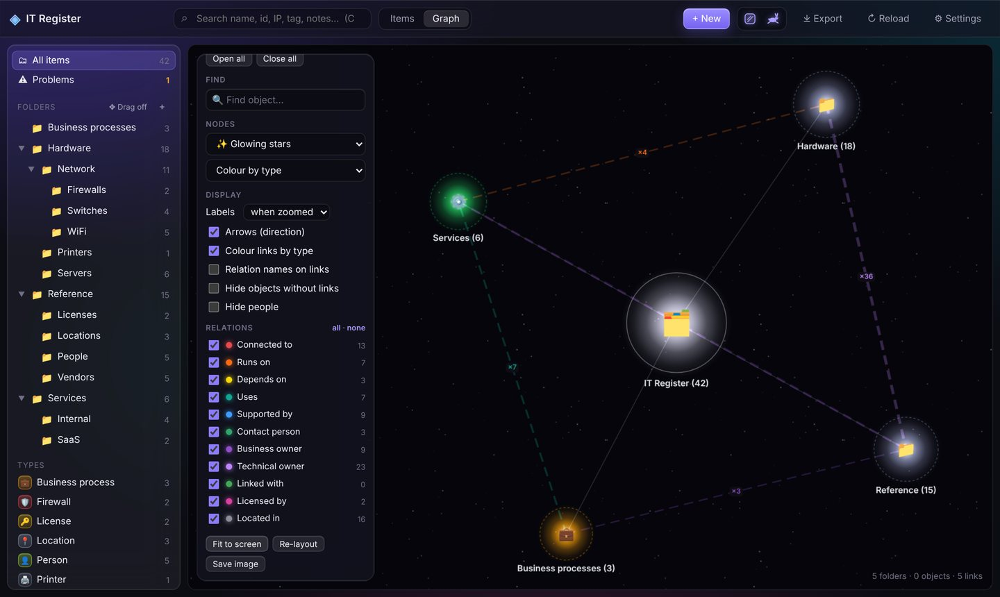

<div align="center">

# ◈ Asterism

**a map of your infrastructure that nobody asked for**

**one html file. a folder of markdown. a graph that glows.**

no server · no database · no install · no login screen · no regrets



</div>

---


## what it is

An IT asset / relations register that lives in a shared folder.

- **`register.html`.** That's the app. Double-click it.
- **A folder of `.md` files.** That's the database. One object per file. Readable, greppable, git-able, survives the app.
- **Relations.** *switch → connected to → firewall*, *process → uses → service → runs on → server*, *vendor → support contact → human*. Bring your own relation types.
- **Templates are suggestions, not a cage.** Add a field to one object. Rename a field across all of them. Make an object with no template at all. Nothing explodes.
- **The graph.** Glowing stars, icons or plain dots. A *structure* mode that unfolds folder by folder. A *network* mode for when you just want to look at it for a while.
- **History.** Every save keeps the previous version. Diff. Restore. Shrug.
- **Exports** for the people who ask for exports:
  - Excel: dependencies, ICT providers, ownership gaps, relations, one sheet per type.
  - draw.io: overview → landscape → one page per business process → network → around any object. Lines that don't cross. Mostly.

<table><tr>
<td></td>
<td></td>
</tr><tr>
<td></td>
<td>

**also**

- business owner / technical owner as real links
- duplicates: warn or refuse, per field
- duplicate an object, create 10 at once
- drag & drop folders and objects
- "someone else changed this" detection
- liquid glass. there's a button to turn it off. there's a rabbit too.

</td>
</tr></table>

## use it

1. Download `register.html`.
2. Open it in **Chrome** or **Edge**. Firefox and Safari can't open folders, not our fault.
3. *Try the demo*, or *Choose register folder* and point it at an empty folder (or at `demo/` from this repo).

That's it. Put the html next to the data on a file share and the whole team uses the same register.
Who changed what is your file server's business: it already logs that.

Want it to look like a real app? A shortcut does it:

```
msedge.exe --app="file://SERVER/share/asterism/register.html"
```

## the database

```
data/
├── objects/                 # your folders = folders in the app
│   └── Network/Switches/
│       └── sw-0003 HQ-SW2.md
├── _templates/*.yaml        # suggestions
├── _relations.yaml          # link types: label, inverse, colour
└── _history/<id>/           # every previous version
```

```markdown
---
id: sw-0003
name: HQ-SW2
template: switch
tags: [hq, network]
fields:
  IP Address: 10.10.0.3
relations:
  - {type: connected_to, target: fw-0001}
  - {type: technical_owner, target: per-0003}
---
Rack 2, top. Don't unplug the blue one.
```

The id lives inside the file, not in the name. Rename, move, reorganise: links don't break.

## build it yourself

You don't have to. `register.html` is already built. But:

```bash
npm install
npm run build        # → register.html (minified, everything inlined)
npm run build:dev    # same, readable
```

`src/app/*.js` is the app, split by topic. `src/core.js` is the file format. `gen-data.cjs` makes the fictional demo company.

## faq

**Is it production ready?**
nah, it is what it is

**Multi-user?**
Yes, if your users don't all edit the same switch in the same second. If they do, it notices and asks.

**Why not just use Obsidian / NetBox / i-doit / GLPI?**
idk they didnt suited me

**Can I import from my old CMDB?**
It's text files. Export a CSV, write a script, have a weekend.

**Who made this?**
not my potato brain ;D

---

<sub>MIT. Bundles <a href="https://github.com/vasturiano/force-graph">force-graph</a>, <a href="https://github.com/nodeca/js-yaml">js-yaml</a> and <a href="https://github.com/markedjs/marked">marked</a> (all MIT). Demo data is fictional. Any resemblance to your network is a sign you should document it.</sub>
